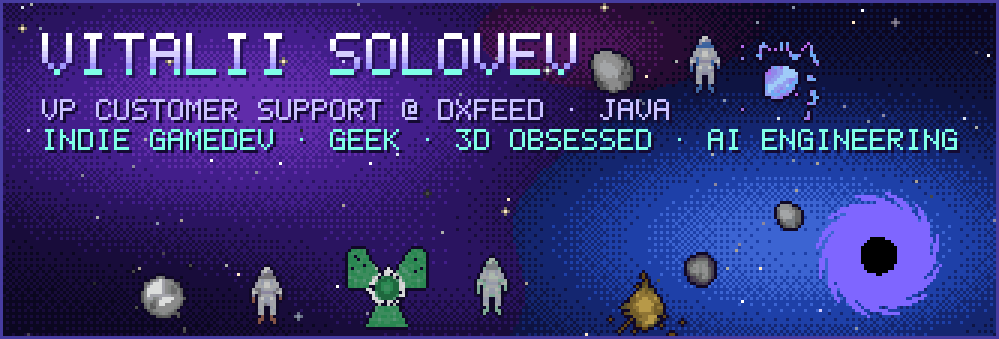
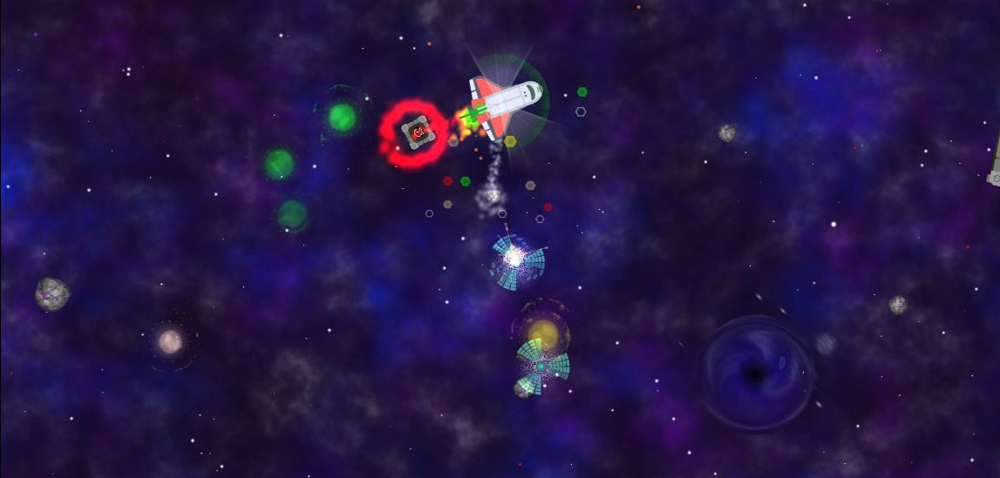
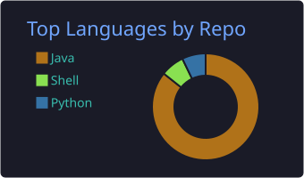
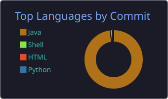
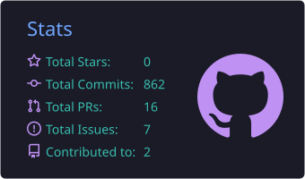

  

  
  
  
  
  
  
  
  

### 👨‍🚀 About

- 🛰️ **VP Customer Support** at [dxFeed](https://dxfeed.com): market data, trading infrastructure, crisis management
- ☕ **Java** by trade
- 🎮 **Indie game dev**: made [Buran-19](https://github.com/soloyes/buran-19), the game this banner is drawn from
- 🧊 **3D obsessed**
- 🤖 **AI engineering**: agents, LLM tooling, automation
- 🤓 Geek

### 🚀 Featured: Buran-19

My indie space arcade on **libGDX** (Android, iOS, Desktop). You fly the Buran shuttle, pull stranded astronauts in with a tractor beam,
dodge asteroids, homing rockets, anomalies and black holes, and try to survive as long as the fuel lasts.
The pixel-art banner at the top of this page is drawn from the game's own sprites.

**[→ Source code, screenshots and build instructions](https://github.com/soloyes/buran-19)**

### 🛰️ Other projects

| Project | What it is |
|---|---|
| [buran-19](https://github.com/soloyes/buran-19) | Space arcade on libGDX, 595 commits of history |
| [zookeeper-kafka-mesh](https://github.com/soloyes/zookeeper-kafka-mesh) | Full-mesh controller for ZooKeeper and Kafka nodes in Docker |
| [OpenShuttle](https://github.com/soloyes/OpenShuttle) | My first libGDX game, the prototype that grew into Buran-19 |
| [JavaTrans2Quik](https://github.com/soloyes/JavaTrans2Quik) | Java wrapper for Trans2Quik.dll (QUIK trading platform) |

### 📊 Stats

  

  
  
  

  <picture>
    <source media="(prefers-color-scheme: dark)" srcset="https://raw.githubusercontent.com/soloyes/soloyes/output/snake-dark.svg"/>
    
  </picture>

